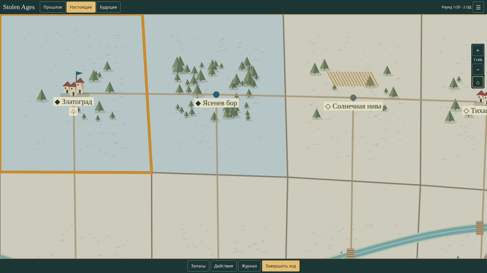

# Stolen Ages

[Играть в Stolen Ages](https://romansachkovskiy.github.io/StolenAges/)

Браузерная пошаговая стратегия версии 0.1.0. Золотой союз соперничает с Алым орденом и Аметистовым двором за одну землю в трёх эпохах. Алый орден отдаёт предпочтение экспансии, Аметистовый двор — развитию и обороне.



## Как играть

Выберите свою территорию на карте, откройте постройки, войска или науку. На ход есть три общих очка действий. Просмотр соседнего региона и смена эпохи бесплатны. Аванпост присоединяет соседнюю нейтральную землю, для захвата вражеской нужен отряд. Застройка в прошлом усиливает производство в последующих эпохах, пока тот же регион принадлежит вам.

После вашего хода действуют оба соперника, затем начисляется доход. Удерживайте столицу, аванпосты или армию. Для досрочной победы захватите 38 из 54 владений. В конце 20-го раунда победителя определяют очки за владения, города, технологии, эхо и запасы. Проектный ориентир — 20–25 минут на ПК и 22–29 минут на телефоне. Это оценка до плейтестов с людьми.

Перетаскивайте карту, приближайте её щипком, колесом мыши или кнопками «+» и «−». Домик возвращает к столице. Клавиши 1–3 переключают эпохи, E открывает подтверждение конца хода, Escape закрывает карточку. В карточке региона доступен список для выбора с клавиатуры. Настройки содержат выбор русского или английского языка.

## Запуск и проверка

Требуется Node.js 22.12+ или 24. Из каталога проекта выполните:

```sh
npm ci
npm run dev
```

Откройте адрес Vite с путём `/StolenAges/`. Для проверки производственной сборки:

```sh
npm run typecheck
npm run lint
npm test
npm run build
npx playwright install chromium
npm run test:browser
npm run preview
```

Для тестирования системным Chromium задайте переменную `CHROMIUM_PATH`. Браузерные тесты загружают собранные файлы и проверяют обе локализации, управление, портретный и альбомный режимы, сохранение, окончание партии и рестарт. Vitest выполняет в том числе 100 воспроизводимых партий двух профилей ИИ.

## Сохранения и публикация

Игра работает без сервера симуляции. Партия и язык сохраняются в localStorage текущего браузера. Очистка данных сайта удаляет сохранение. На экране результата можно скачать JSON со статистикой партии. Автоматической отправки игровых данных нет.

Проверки запускаются при push в main. После успешных проверок каждого push в main запускается публикация, которую также можно повторить через Actions → Check and publish → Run workflow → Publish the verified build. Источник Pages в настройках репозитория — GitHub Actions. Завершающий шаг проверяет запуск опубликованной сборки и ставит тег v0.1.0 только для релизного коммита.

© 2026 Roman Sachkovskiy. Все права защищены. [LICENSE](LICENSE)
