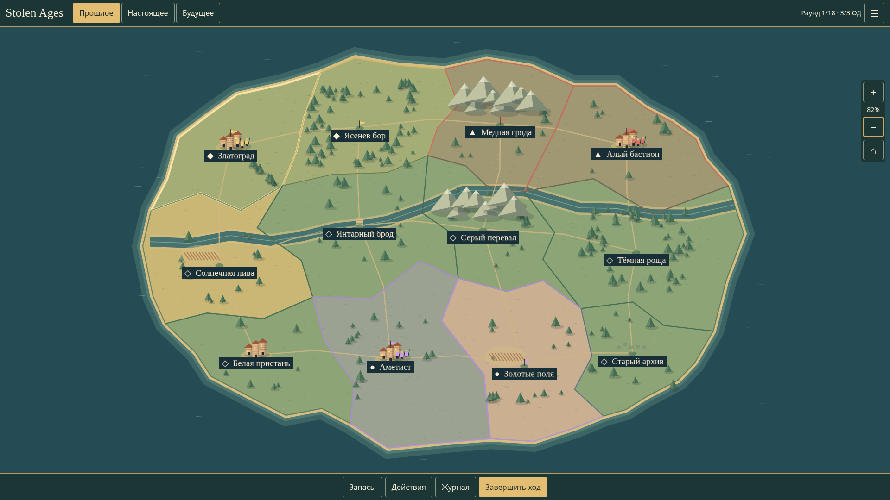
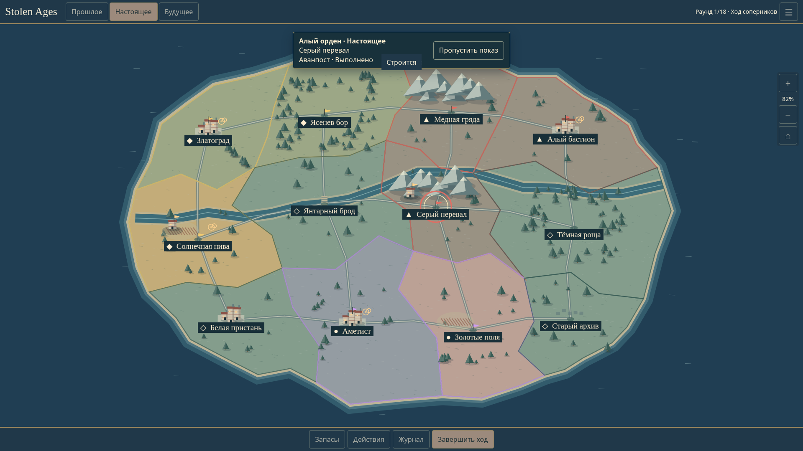
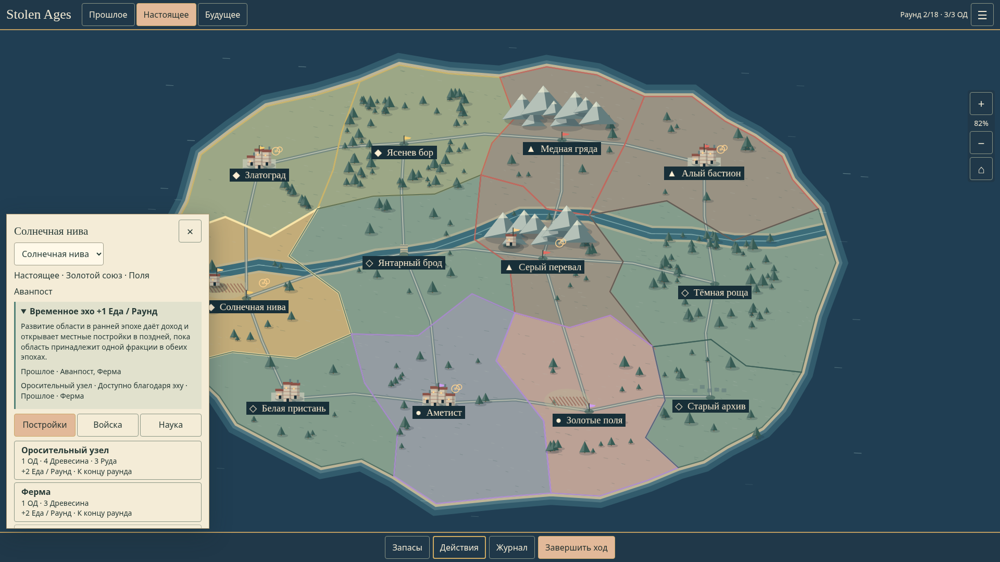

### Что изменилось

- Цельная карта с 12 областями, естественными границами и графикой для каждой эпохи.
- Видимые ходы соперников, понятнее карточки действий и новые сооружения, которые открывает временное эхо.

Полный список изменений

**Карта и эпохи.** Извилистый берег окружает 12 областей. Постройки видны у полей, склонов и переправ. Эпохи различаются архитектурой, отрядами и инфраструктурой. Вода, флаги и работающие сооружения движутся.

**Ходы соперников.** Приказы показываются по очереди с эпохой, областью и итогом. Показ можно пропустить. Все приказы доступны в журнале.

**Временное эхо.** Карточка области показывает, какое действие в ранней эпохе даёт доход позже. Ферма на полях открывает оросительный узел, шахта на гряде или перевале — обогатительный цех, а укрепление у переправы — укреплённый мост. Для эффекта фракция должна владеть областью в обеих эпохах.

**Действия и правила партии.** В карточках видны цена, эффект, срок выполнения и причины блокировки. Партия длится до 18 раундов. В игре четыре ресурса и 12 технологий. После закрытия или перезагрузки вкладки игра открывается с главного меню.

[Сравнение версий на GitHub](https://github.com/RomanSachkovskiy/StolenAges/compare/v0.1.0...v0.2.0)
