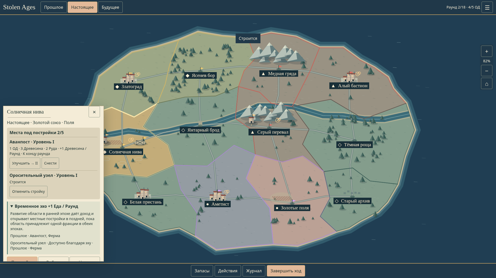
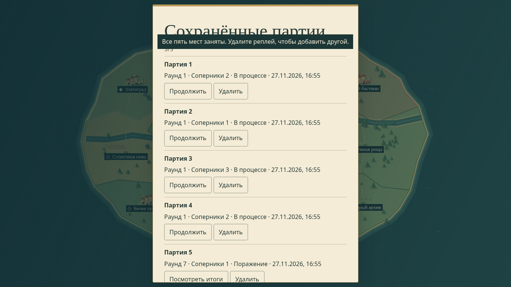
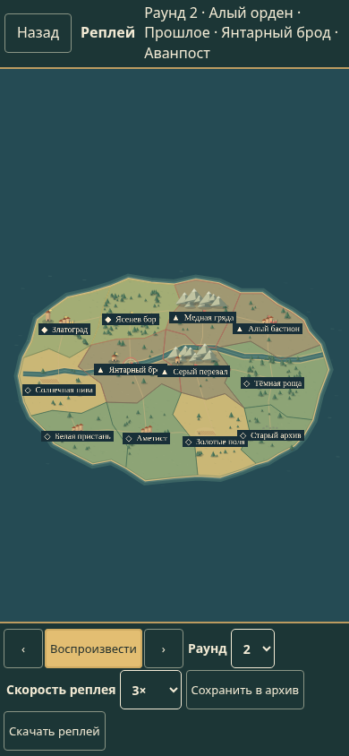

### Что изменилось

- Выбор числа соперников, три скорости показа приказов и пять мест под постройки в каждой области. Здания можно сносить и улучшать до III уровня.
- Ручные сохранения, автосохранение и реплеи завершённых партий. Реплеи можно смотреть, скачать или добавить в отдельный архив.

Полный список изменений

**Партии и соперники.** Можно выбрать одного, двух или трёх противников. Каждая фракция получает соответственно 3, 5 или 8 очков действий на свой ход. Скорость показа приказов можно менять по ходу просмотра. По умолчанию установлена средняя.

**Постройки и поселения.** В каждой области одной эпохи пять мест. Снос возвращает половину базовой стоимости, улучшения до II и III уровней усиливают эффект постройки. Развитие столицы или поселения доступно там, где оно уже существует.

**Сохранения партий.** В настройках можно включить ручную запись и автосохранение каждые 10 секунд, 30 секунд или минуту. Из пяти слотов можно продолжить незавершённую партию или открыть итоги завершённой.

**Реплеи.** Есть перемотка по шагам и раундам и скорости от 0,5× до 3×. Каждая завершённая сохранённая партия хранит свой реплей. В отдельный архив помещается до пяти копий или импортированных файлов.

